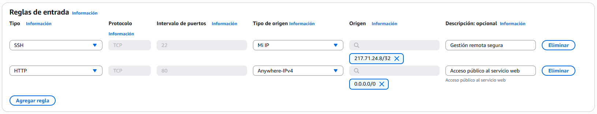

# PR0301: Despliegue automatizado de servidor web mediante User Data y metadatos IMDSv2

## Paso 1: Creación del Grupo de Seguridad *(Security Group)*

Para definir una política, tendremos que ir hacia `EC2 > Red y seguridad > Security Groups` y clicamos en **Crear grupo de seguridad**.

En el apartado de **Detalles básicos**, pondremos los siguiente:
- **Nombre del grupo de seguridad:** servidor-web-asir
- **Descripción:** Permitir acceso HTTP publico y SSH desde el aula
- **VPC:** Seleccionar la VPC por defecto del laboratorio.

En **Reglas de entrada**, clicamos en el botón de **Agregar regla** 2 veces y pondremos lo siguiente:

En **Reglas de salida**, lo dejamos por defecto y más abajo clicamos en el botón de **Crear grupo de seguridad**.

## Paso 2: Análisis del Script de User Data

## Paso 3: Lanzamiento de la Instancia EC2

## Paso 4: Verificación y resolución de problemas

[Volver a la página anterior](../index.md)