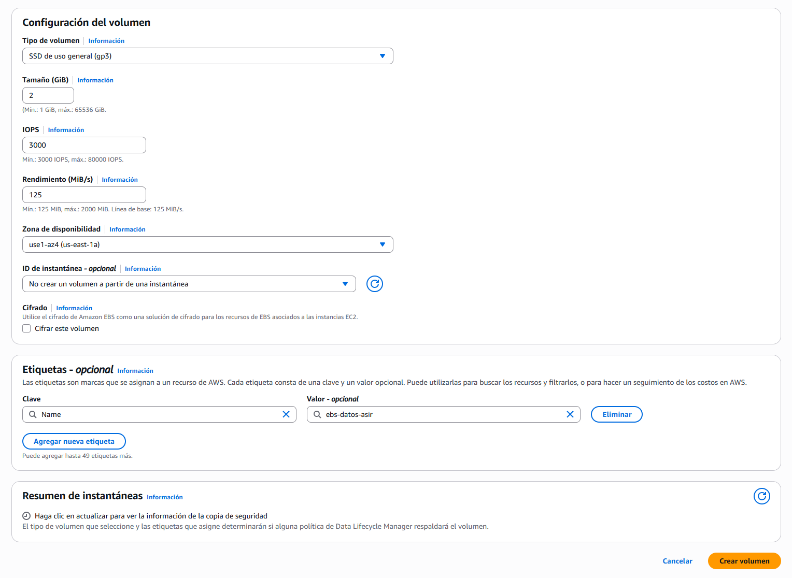
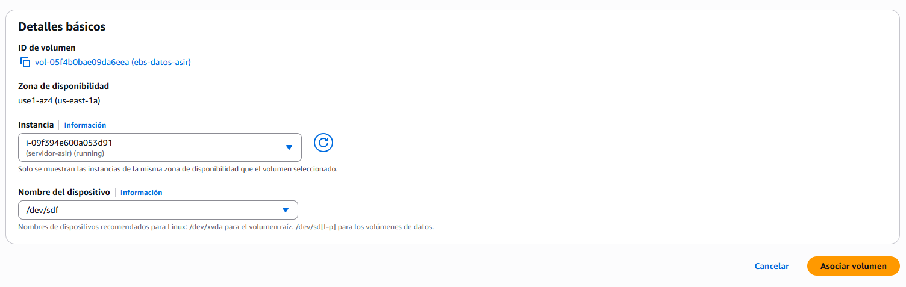
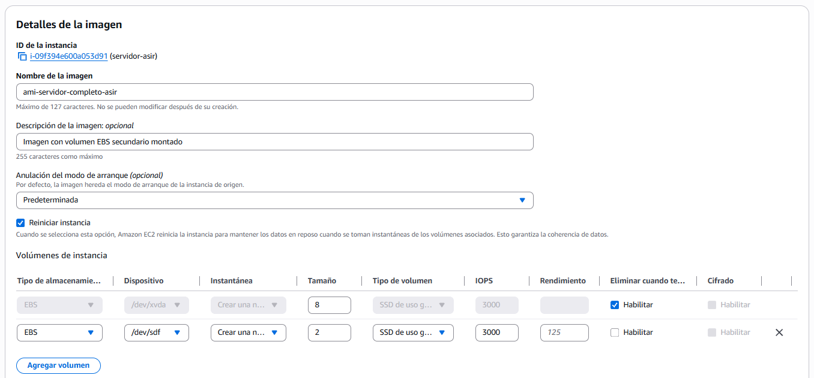
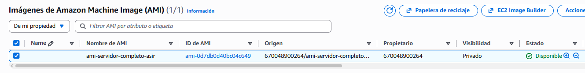
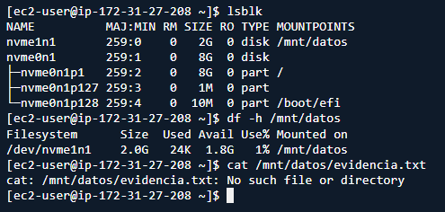

# PR0302: Gestión de volúmenes EBS secundarios y clonación con AMIs

## Paso 1: Verificación de la zona y lanzamiento de la máquina base
Creamos una instancia que tenga el nombre de `servidor-asir`, seleccionamos la imagen de `Amazon Linux` y el tipo de instancia será `t3.micro`.  
Después, agregamos nuestro par de claves y agregamos el grupo de seguridad creado en el [ejercicio anterior](../pr0301/pr0301.md). Clicamos en **Lanzar instancia**.

## Paso 2: Creación y conexión del volumen EBS
Una vez creada la instancia, nos vamos al menú de la izquerda y nos iremos hacia `Elastic Block Store > Volúmenes`. Clicamos en el botón de **Crear volmen** y pondremos los siguientes valores:
- **Tipo de volumen:** gp3
- **Tamaño:** 2 GiB
- **Zona de disponibilidad:** us-east-1a
- **Etiquetas:** Clave - `Name` y Valor - `ebs-datos-asir`



Clicamos en **Crear volumen**. Esperamos unos segundos a que se cree y cuando lo tengamos clicamos el checkbox que aparece a la izquierda y vamos al apartado de **Acciones** seleccionamos **Asociar volumen** y pondremos lo siguiente:
- **Instancia:** la máquina a la que queremos asociar el volumen.
- **Nombre del dispositivo:** /dev/sdf



Clicamos en el botón de asociar volumen y esperamos un poco hasta que nos aparezca un mensaje en verde de que ya está asociado.

## Paso 3: Configuración del almacenamiento en el sistema operativo

Nos conectamos por SSH con el siguiente comando:
```bash
ssh -i clave-hbf-cloud.pem ec2-user@54.242.43.69
```

Ponemos el comando `lsblk` y veremos el árbol del sistema.
```
NAME          MAJ:MIN RM SIZE RO TYPE MOUNTPOINTS
nvme1n1       259:0    0   2G  0 disk 
nvme0n1       259:1    0   8G  0 disk 
├─nvme0n1p1   259:2    0   8G  0 part /
├─nvme0n1p127 259:3    0   1M  0 part 
└─nvme0n1p128 259:4    0  10M  0 part /boot/efi
```

El disco principal tiene como nombre `nvme0n1`, y el disco que hemos agregado anteriormente, tiene como nombre `nvme1n1`.

Ponemos el comando `sudo file -s /dev/nvme1n1`. Si vemos que solamente nos devuelve `/dev/nvme1n1: data`, tendremos que formatearlo.

Para formateralo con el sistema de archivos `ext4` pondremos el comando `sudo mkfs -t ext4 /dev/nvme1n1`.

Creamos el directorio que nos servirá como punto de montaje. Ponemos el comando `sudo mkdir -p /mnt/datos`, y asociamos el disco con el comando `sudo mount /dev/nvme1n1 /mnt/datos`.

Creamos un archivo de prueba para comprobar los datos:
```bash
echo "Datos de producción en volumen EBS - $(date)" | sudo tee /mnt/datos/evidencia.txt
ls -la /mnt/datos/
```

Resultado:
```
Datos de producción en volumen EBS - Tue Oct 20 16:39:00 UTC 2026

total 4
drwxr-xr-x. 2 root root 27 Oct 20 16:39 .
drwxr-xr-x. 3 root root 19 Oct 20 10:30 ..
-rw-r--r--. 1 root root 67 Oct 20 16:39 evidencia.txt
```

## Paso 4: Automatización del montaje en `/etc/fstab` mediante UUID
Para obtener el UUID que está asignado a la partición o disco formateado, pondremos el comando `sudo blkid /dev/nvme1n1`.

Para crear una copia de respaldo en caso de que lo eliminemos, pondremos el comando `sudo cp /etc/fstab /etc/fstab.bak`.

Editamos en archivo /etc/fstab con el comando `sudo nano /etc/fstab` y pegamos la siguiente línea junto con nuestro UUID:
```
UUID=3acefd69-1457-4dcc-9751-db30416bd642    /mnt/datos    ext4    defaults,nofail    0    2
```

Ahora, para comprobar que todo sea correcto antes de reiniciar, desmontamos el disco con el comando `sudo umount /mnt/datos` y luego lo volveremos a montar de manera forzada con el comando `sudo mount -a`. Si vemos que al volver a montar el disco no ha salido un mensaje de error, podremos poner el comando `df -h /mnt/datos` y el disco volverá a aparecer montado y con la configuración correcta y segura frente a reinicios.
```
Filesystem      Size  Used Avail Use% Mounted on
/dev/nvme1n1    2.0G   24K  1.8G   1% /mnt/datos
```

## Paso 5: Creación de la AMI *(Amazon Machine Image)*
Vamos a `EC2 > Instancias`, seleccionamos nuestra instancia y vamos a `Acciones > Imagen y plantillas > Crear imagen`. Pondremos los siguientes datos:
- **Nombre de la imagen:** ami-servidor-completo-asir
- **Descripción de la imagen:** Imagen con volumen EBS secundario montado

En el apartado de **Volúmenes de instancia**, veremos que tenemos tanto el disco del sistema, como el que hemos montado anteriormente. Más abajo, clicamos en **Crear imagen**.



Ahora, en el menú de la izquierda, vamos a `Imágenes > AMI` y veremos que tendremos la imagen creada. Esperamos unos minutos a que el estado pase de `Pendiente` a `Disponible`.



## Paso 6: Lanzamiento y verificación de la instancia clonada
Con la instancia en el estado `En ejecución`, en el menú de la izquerda vamos a `Imágenes > AMI`, seleccionamos la instancia que hicimos anteriormente y clicamos en el botón de `Lanzar instancia a partir de una AMI`. Veremos que tendremos un menú igual que cuando creamos una instancia de normal. Haremos lo siguiente:
- **Nombre y etiquetas:** servidor-clonado-asir
- **Tipo de instancia:** t3.micro
- **Par de claves:** Nuestro par de claves.
- **Configuraciones de red:** Asegurarse de que `Asignación automática de IP pública` esté habilitada.
- **Firewall (grupos de seguridad):** Clicamos en la opción de seleccionar grupo de seguridad existente y seleccionamos nuestro grupo.
- **Configuración de almacenamiento:** Verificar que tendremos dos discos, el principal de 8 GiB y el secundario de 2 GiB.

Cuando todo esté configurado, clicamos en `Lanzar instancia`.

Esperado unos minutos a que el estado de la nueva máquina pase a `En ejecución`, nos conectaremos por **SSH** con el siguiente comando:
```bash
ssh -i clave-hbf-cloud.pem ec2-user@54.163.32.74
```

Verificamos que el disco secundario y los archivos existen en la máquina clonada con los siguientes comandos:
```bash
lsblk
df -h /mnt/datos
cat /mnt/datos/evidencia.txt
```

Resultado:



> No se porque no encuentra el archivo si tanto el volumen como el directorio está clonado.

[Volver a la página anterior](../index.md)