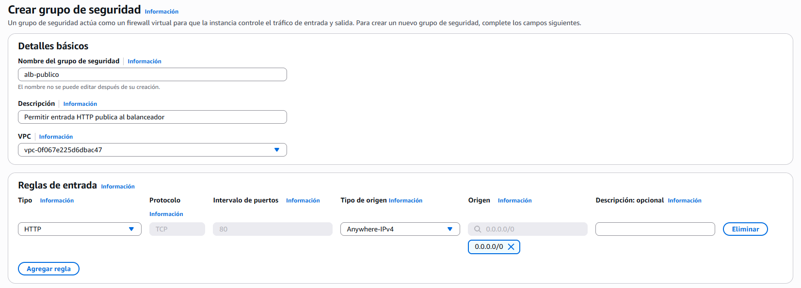
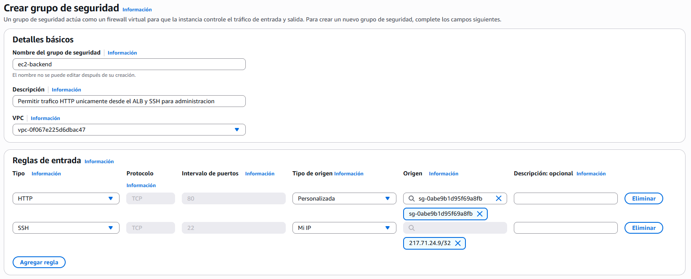

# PR0303: Arquitectura web redundante con Application Load Balancer y Auto Scaling

## Paso 1: Configuración de los Security Groups encadenados
Vamos a `Red y seguridad > Security Groups` y creamos un grupo de seguridad en el que tiene que tener lo siguiente:
- **Nombre del grupo de seguridad:** alb-publico
- **Descripción:** Permitir entrada HTTP publica al balanceador
- **VPC:** Por defecto
- **Regla de entrada:** Tipo `HTTP`, Puerto `80`, Origen `0.0.0.0/0`



El identificador del grupo será `sg-0abe9b1d95f69a8fb`.

Creamos un segundo grupo de seguridad con los siguientes datos:
- **Nombre del grupo de seguridad:** ec2-backend
- **Descripción:** Permitir trafico HTTP unicamente desde el ALB y SSH para administracion
- **VPC:** Por defecto
- **Regla de entrada 1:** Tipo `HTTP`, Puerto `80`, ponemos de origen la regla que hemos creado anteriormente.
- **Regla de entrada 2:** Tipo `SSH`, Puerto `22`, Origen `Mi IP`



## Paso 2: Creación de la plantilla de lanzamiento
Vamos a `Instancias > Instancias` y lanzamos una instancia con la siguiente configuración:
- **Nombre:** lt-servidor-web-asir
- **Imágenes de aplicaciones:** Amazon Linux 2023
- **Tipo de instancia:** t3.micro
- **Par de claves:** Nuestro par de claves
- **Configuraciones de red:** Seleccionar el grupo de seguridad `ec2-backend`.
- **Detalles avanzados > Versión de metadatos:** Solo V2
- **User data:**: Pegamos el siguiente script:
```bash
#!/bin/bash
 dnf update -y
 dnf install -y httpd stress

 systemctl enable httpd
 systemctl start httpd

 TOKEN=$(curl -s -X PUT "http://169.254.169.254/latest/api/token" -H "X-aws-ec2-metadata-token-ttl-seconds: 21600")
 INSTANCE_ID=$(curl -s -H "X-aws-ec2-metadata-token: $TOKEN" http://169.254.169.254/latest/meta-data/instance-id)
 AZ=$(curl -s -H "X-aws-ec2-metadata-token: $TOKEN" http://169.254.169.254/latest/meta-data/placement/availability-zone)
 PRIVATE_IP=$(curl -s -H "X-aws-ec2-metadata-token: $TOKEN" http://169.254.169.254/latest/meta-data/local-ipv4)

 cat <<EOF > /var/www/html/index.html
 <!DOCTYPE html>
 <html lang="es">
 <head>
     <meta charset="UTF-8">
     <title>Cluster Web ASIR</title>
     <style>
         body { font-family: monospace; background-color: #0f172a; color: #f8fafc; text-align: center; padding-top: 50px; }
         .box { display: inline-block; background: #1e293b; padding: 30px; border-radius: 12px; border: 2px solid #38bdf8; }
         h1 { color: #38bdf8; }
         .data { font-size: 1.2rem; margin: 10px 0; }
         .highlight { color: #facc15; font-weight: bold; }
     </style>
 </head>
 <body>
     <div class="box">
         <h1>Servidor Backend Operativo</h1>
         <p class="data">Instancia: <span class="highlight">$INSTANCE_ID</span></p>
         <p class="data">Zona de Disponibilidad: <span class="highlight">$AZ</span></p>
         <p class="data">IP Privada: <span class="highlight">$PRIVATE_IP</span></p>
     </div>
 </body>
 </html>
 EOF
```

Y clicamos en **Lanzar instancia**.

## Paso 3: Creación del Target Group
Vamos a `Equilibrio de carga > Grupos de destino`, clicamos en **Crear grupo de destino** y creamos el grupo con la siguiente configuración:
- **Tipo de destino:** Instancias
- **Nombre del grupo de destino:** tg-web-asir
- **Protocolo:** HTTP
- **Puerto:** 80
- **VPC:** Por defecto
- **Protocolo de comprobación de estado:** HTTP
- **Ruta de comprobación de estado:** /
- Configuración avanzada de comprobación de estado:
  - **Umbral en buen estado:** 2
  - **Umbral en mal estado:** 2
  - **Intervalo:** 10 segundos

Clicamos en **Siguiente** y no registraremos ninguna instancia manualmente porque **Auto Scaling Group** ya lo hace de manera automática.

Volvemos a clicar en **Siguiente** y luego en **Crear grupo de destino**.

## Paso 4: Creación del Application Load Balancer (ALB)


## Paso 5: Creación del Auto Scaling Group (ASG)


## Paso 6: Verificación del balanceo de carga


## Paso 7: Prueba de estrés y validación del autoescalado


[Volver a la página anterior](../index.md)