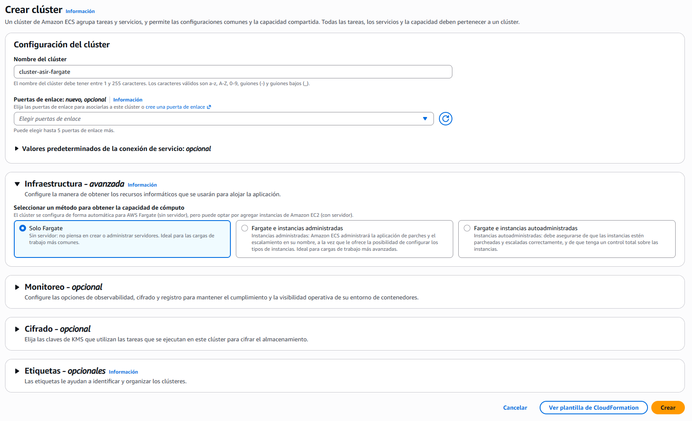
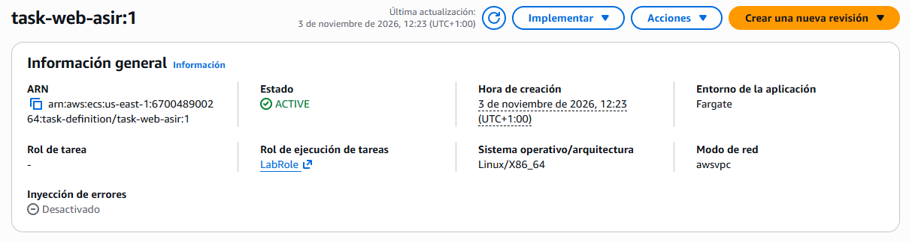
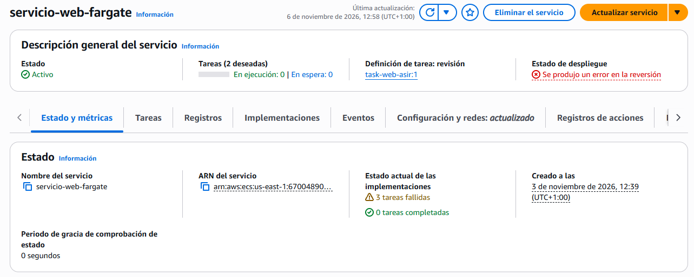

# PR0304: Despliegue de servicios en contenedores con Amazon ECS sobre AWS Fargate

## Paso 1: Creación del clúster ECS con AWS Fargate
Escribimos en el buscador y clicamos en el servicio que pone **Elastic Container Service**.

En el menú, clicamos en **Clústers** y luego en **Crear clúster**.  
Pondremos la siguiente configuración:

## Paso 2: Creación de la Definición de Tarea (*Task Definition*)
En el menú, clicamos en **Definiciones de tarea** y luego en **Crear nueva definición de tarea**.  
Pondremos la siguiente configuración:

Infraestructura:
- **Familia de definición de tareas:** task-web-asir
- **Tipo de lanzamiento:** AWS Fargate
- **Sistema Operativo:** Linux/X86_64
- **Modo de red:** awsvpc (con Fargate no podremos cambiarlo porque es obligatorio)
- **CPU:** 0.25 vCPU (.25 vCPU)
- **Memoria:** 0.5 GB (.5 GB)
  
Roles de tarea:
- **Rol de ejecución de tareas:** Seleccionamos `LabRole`.

Contenedor 1:
- **Nombre:** web-nginx
- **URI de imagen:** Utilizar una imagen pública estándar de Docker Hub, por ejemplo: `nginx:alpine`.
- **Puerto:** 80
- **Protocolo:** TCP
- **Protocolo de aplicación:** HTTP

Una vez configurado, clicamos en **Crear**.

## Paso 3: Despliegue del Servicio ECS
Dentro de la tarea creada, en el menú de arriba clicamos en `Implementar > Crear servicio`.  
Haremos la siguiente configuración:
- **Nombre del servicio:** servicio-web-fargate

Entorno:
- **Opciones informáticas:** Tipo de lanzamiento
- **Tipo de lanzamiento:** Fargate

Configuración de implementación:
- **Tareas deseadas:** 2

Redes:
- **VPC:** Por defecto
- **Subredes:** Elegimos 2, en mi caso, `us-east-1a` y `us-east-1b`.
- **Grupo de seguridad:** Elegimos `servidor-web-asir`. O creamos uno nuevo con el puerto `80` por `HTTP` desde `0.0.0.0/0`.
- **IP pública:** Activado.

Clicamos en **Crear**.

## Paso 4: Verificación y prueba de acceso
En el menú de la izquierda, clicamos en `Clústeres` y debajo de la descripción, clicamos en `Servicios` y seleccionamos el servicio que acabamos de crear.  
Vamos a la pestaña de `Tareas` y veremos que tendremos dos tareas.

[Volver a la página anterior](../index.md)