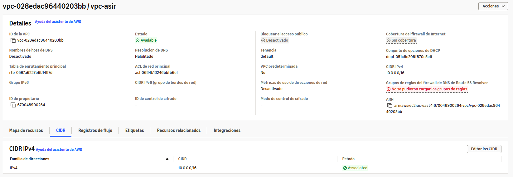
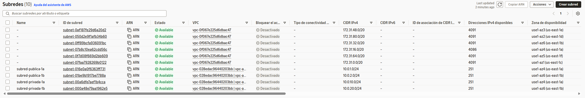
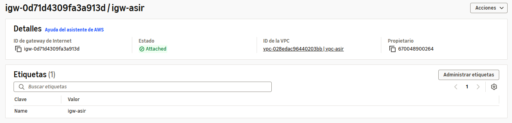
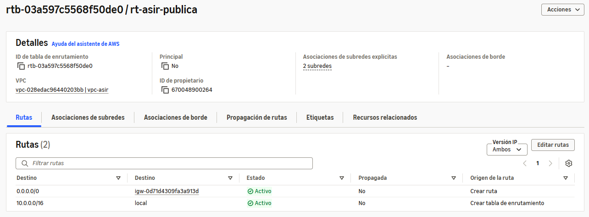
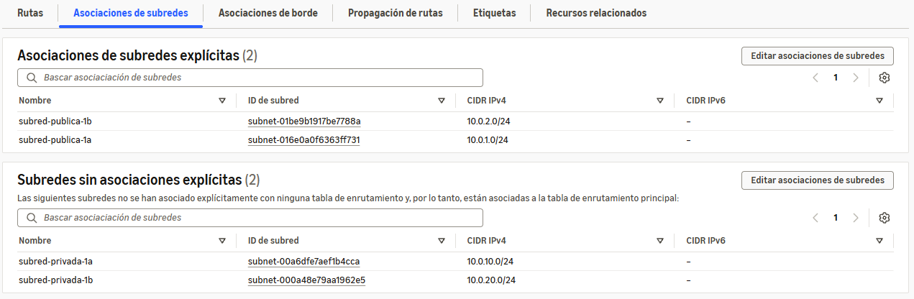
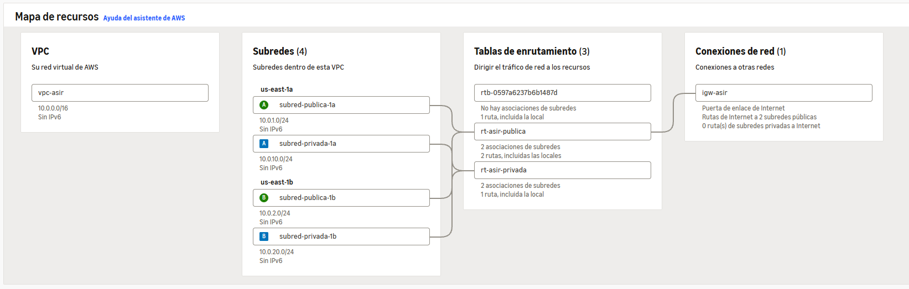
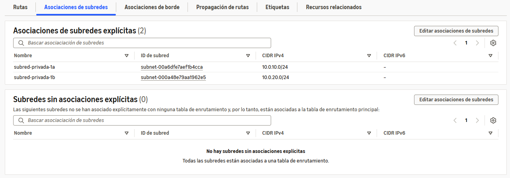
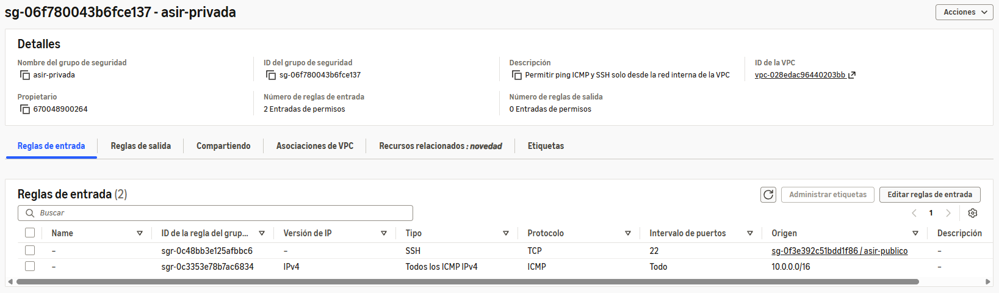
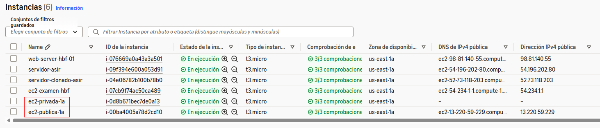

# PR0401: Diseño y construcción de una VPC desde cero

## Paso 1: Creación de la VPC
En el buscador escribimos **VPC** y seleccionamos la primera opción. Luego, clicamos en `Sus VPC > Crear VPC` y creamos una VPC con la siguiente configuración:

- **Etiqueta de nombre:** vpc-asir
- **Bloque de CIDR IPv4 manual:** 10.0.0.0/16
- **Bloque de CIDR IPv6:** Sin bloque
- **Tenencia:** Predeterminado

Clicamos en **Crear VPC**.



Dentro de la VPC recien creada, clicamos en `Acciones > Editar la configuración de VPC`. Dentro, tenemos que tener habilitado en el apartado de **Configuración de DNS** las dos opciones que vienen.

## Paso 2: Creación del esquema de subredes (Públicas y Privadas)
En el menú lateral, clicamos en `Subredes > Crear subred`. Vamos a crear **4 subredes**, antes de crearlas, seleccionamos la **VPC** que creamos anteriormente.

- **Subred 1:**
  - **Nombre de la subred:** subred-publica-1a
  - **Zona de disponibilidad:** US East (N. Virginia) / us-east-1a
  - **Bloque de CIDR de la subred IPv4:** 10.0.1.0/24
- **Subred 2:**
  - **Nombre de la subred:** subred-publica-1b
  - **Zona de disponibilidad:** US East (N. Virginia) / us-east-1b
  - **Bloque de CIDR de la subred IPv4:** 10.0.2.0/24
- **Subred 3:**
  - **Nombre de la subred:** subred-privada-1a
  - **Zona de disponibilidad:** US East (N. Virginia) / us-east-1a
  - **Bloque de CIDR de la subred IPv4:** 10.0.10.0/24
- **Subred 4:**
  - **Nombre de la subred:** subred-privada-1b
  - **Zona de disponibilidad:** US East (N. Virginia) / us-east-1b
  - **Bloque de CIDR de la subred IPv4:** 10.0.20.0/24



Clicamos en `subred-publica-1a > Acciones > Editar la configuración de la subred`. Habilitamos **Habilitar la asignación automática de la dirección IPv4 pública** y guardamos. Haremos lo mismo para `subred-publica-1a`.

## Paso 3: Creación y conexión de Internet Gateway (IGW)
En el menú lateral, clicamos en `Gateway de Internet > Crear gateway de Internet`.  
Le pondremos el nombre que será `igw-asir` y clicamos en **Crear gateway**.  
Una vez creada, clicamos en ella y vamos a `Acciones > Conectar a una VPC` y conectamos la **VPC** que hemos creado.



## Paso 4: Configuración de Tablas de Enrutamiento (Route Tables)
En el menú lateral, clicamos en `Tablas de enrutamiento > Crear tabla de enrutamiento`.  
Le pondremos la siguiente configuración:
- **Nombre:** rt-asir-publica
- **VPC:** seleccionamos la que hemos creado

Cuando ya esté creada, clicamos en `Acciones > Editar rutas` y comprobamos que la IP a la que está apuntando es la `10.0.0.0/16` con destino a `local`.  
Creamos una nueva ruta con la IP `0.0.0.0/0` con destino a `Puerta de enlace de Internet` y seleccionamos la puerta de enlace que hemos creado (igw-asir). Guardamos los cambios.  
Volvemos a clicar en `Acciones > Editar asociaciones de subredes` y marcamos las dos subredes **públicas** que hemos creado anteriormente. Y guardamos los cambios.



Crearemos ahora una tabla de rutas privadas. Clicamos en `Crear tabla de enrutamiento` y pondremos la siguiente configuración:
- **Nombre:** rt-asir-privada
- **VPC:** seleccionamos la que hemos creado

Una vez creada, comprobaremos de nuevo que la IP a la que está apuntando es la `10.0.0.0/16` con destino a `local`, no añadiremoso otra a mayores y solamente agregamos las subredes privadas.



Para realizar la comprobación, iremos hacia `Sus VPC`, clicamos en la que hemos creado y en los detalles de abajo, clicaremos en `Mapa de recursos` y veremos de forma gráfica lo que hemos ido haciendo.



## Paso 5: Creación de los Security Groups en la nueva VPC
Ahora, nos iremos hacia **EC2** e iremos a `Grupos de Seguridad > Crear grupo de seguridad`. Pondremos la siguiente configuración para las instancias públicas:
- **Nombre del grupo de seguridad:** asir-publico
- **Descripción:** Permitir SSH desde mi TP
- **VPC:** Seleccionamos la VPC que hemos creado.
- **Reglas de entrada:** SSH por el puerto 22 hacia nuestra IP pública.
- **Reglas de salida:** Eliminamos el que viene por defecto.



Ahora, creamos otro grupo de seguridad para las instancias privadas con la siguiente configuración:
- **Nombre del grupo de seguridad:** asir-privado
- **Descripción:** Permitir ping ICMP y SSH solo desde la red interna de la VPC
- **VPC:** Seleccionamos la VPC que hemos creado.
- **Reglas de entrada:**
  - **Regla 1:** Todos los ICMP IPv4, origen personalizado con la IP `10.0.0.0/16`.
  - **Regla 2:** SSH por el puerto 22, con origen personalizado y lo apuntamos hacia el grupo de `asir-publico`.
- **Reglas de salida:** Eliminamos el que viene por defecto.



## Paso 6: Despliegue de instancias EC2 de validación
Iremos a `Instancias > Lanzar instancia` y pondremos la siguiente configuración para la instancia pública:
- **Nombre:** ec2-publica-1a
- **AMI:** Amazon Linux 2023
- **Tipo de instancia:** t3.micro
- **Par de claves:** Nuestro par de claves
- En Configuraciones de red, clicamos en **Editar**.
  - **VPC:** vpc-asir
  - **Subred:** subred-publica-1a
  - **Asignación automática de IP:** Habilitado
  - **Firewall:** Seleccionamos el grupo de asir-publico

Clicamos en Lanzar instancia.  
Ahora, haremos otra instancia pero privada:
- **Nombre:** ec2-privada-1a
- **AMI:** Amazon Linux 2023
- **Tipo de instancia:** t3.micro
- **Par de claves:** Nuestro par de claves
- En Configuraciones de red, clicamos en **Editar**.
  - **VPC:** vpc-asir
  - **Subred:** subred-privada-1a
  - **Asignación automática de IP:** Comprobar que aparezca en Deshabilitado.
  - **Firewall:** Seleccionamos el grupo de asir-publico



## Paso 7: Pruebas de diagnóstico y verificación de conectividad
Estando en el panel de **Instancias**, podremos comprobar que la instancia privada no tiene IP pública pero si tiene privada dentro de la subred asignada, y la instancia pública si la tiene IP pública y su IP privada se encuentra dentro del rango de la subred que le asignamos.

Instancia pública:
- IP pública: 13.220.59.229
- IP privada: 10.0.1.94

Instancia privada:
- IP pública: -
- IP privada: 10.0.10.114

Nos conectamos por SSH hacia la instancia pública.
```bash
ssh -i clave-hbf-cloud.pem ec2-user@13.220.59.229
```

**Prueba 1:**


[Volver a la página anterior](../index.md)